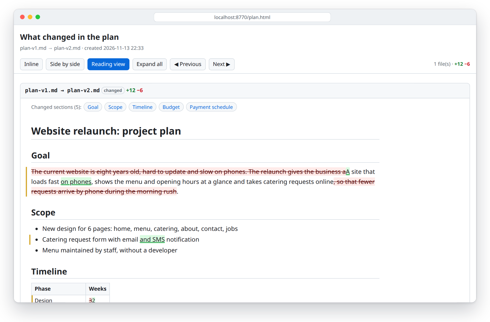
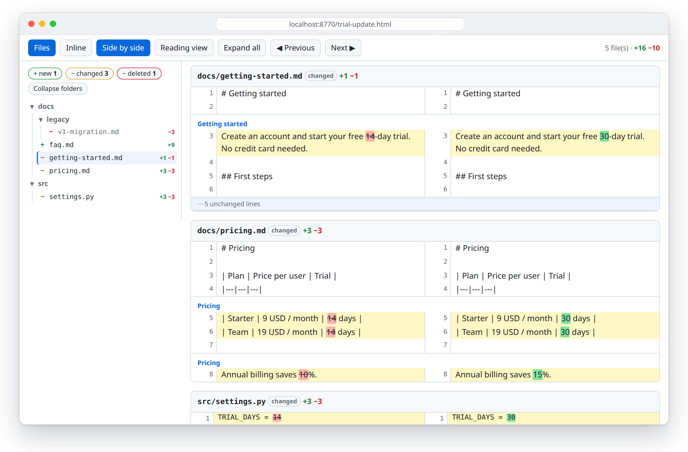

<p align="center">
  <a href="https://automaze.me">
    <picture>
      <source media="(prefers-color-scheme: dark)" srcset="docs/automaze-logo-white.svg">
      
    </picture>
  </a>
</p>

<h1 align="center">diff-view</h1>

<p align="center">
  <strong>See exactly what your AI agent changed.</strong><br>
  A free skill for Claude Code: say "show me the diff" and a readable redline opens in your browser,<br>
  for single files, whole folders, or two versions of the agent's own answer.
</p>

<p align="center">
  
  
  
  <a href="LICENSE"></a>
  <a href="https://automaze.me"></a>
</p>

<p align="center">
  <picture>
    <source media="(prefers-color-scheme: dark)" srcset="docs/reading-view-dark.png">
    
  </picture>
</p>

## Why

Ask an AI agent to change a long document, and the whole thing comes back: just as long, and almost the same. Did it change only what you asked for? Did a date or a price move somewhere else?

diff-view answers that on one page. You read the marked words instead of rereading everything.

## What you get

- **Word-level redline.** Only the words that changed light up, not whole lines.
- **Reading view for Markdown.** The document typeset the way people will read it: additions underlined green, deletions struck red, the changed sections listed at the top.
- **Inline or side by side.** Unchanged runs fold away, and `n` / `p` jump from change to change.
- **Whole folders.** A file tree beside the diff, with filters for new, changed and deleted files.
- **The agent's own answers.** "What changed between your last two answers?" works as well as files and branches.
- **One self-contained HTML file.** No CDN and no external requests. Dark mode included, and it works on a phone.

<p align="center">
  <picture>
    <source media="(prefers-color-scheme: dark)" srcset="docs/folder-dark.png">
    
  </picture>
  <br><sub>A whole folder: file tree with filters, side by side, word-level marks.</sub>
</p>

## Install

```bash
git clone https://github.com/automaze-me/skill-diff-view.git ~/.claude/skills/diff-view
```

That makes the skill available in every project. For one project only, clone it into `.claude/skills/diff-view` inside that project. Skills load at session start, so start a new Claude Code session afterwards.

You need Python 3 (standard library only), git for repository diffs, and a browser.

## Use

Just ask the agent:

> Show me the diff.
>
> What changed between your last two answers?
>
> Compare the docs folder with main.
>
> Redline old-contract.md against new-contract.md.

The agent builds the page, starts a small local server and hands you the link. The script also works on its own:

| Want | Command |
|---|---|
| uncommitted changes, new files included | `diffview.py` |
| a folder against a branch | `diffview.py docs/ --from main` |
| any two files | `diffview.py --files old.md new.md` |
| a new document to review | `diffview.py --new plan.md` |
| serve the pages / show their URLs | `diffview.py serve` / `diffview.py status` |

The script lives in `scripts/` (run it with `python3 -I`); `diffview.py --help` lists every option. Pages go to `.diffview/` in the repository, which git ignores.

## Reading it on another device

The server listens on localhost by default. If the agent runs on another machine (over SSH, on a home server) or you want to read the page on your phone, start it with `--lan` or set `DIFFVIEW_LAN=1`: it then listens on every interface and prints LAN and Tailscale addresses. Anyone on that network can read the pages while the server runs, so keep secrets out of the diff. An SSH tunnel (`ssh -L 8770:localhost:8770 yourhost`) works without `--lan`.

## Language

The page labels are English. `--lang de` or `DIFFVIEW_LANG=de` switches them to German.

## Tests

```bash
python3 -I -m unittest discover -s tests
```

The Markdown renderer tests need `node` and the browser tests `google-chrome`; both are skipped when missing.

## License

MIT, see [LICENSE](LICENSE). Includes [marked](https://github.com/markedjs/marked) 15.0.12 (MIT, license in `scripts/vendor/`). The automaze.me name and logo are not covered by the license.

<br>
<p align="center">
  <sub>Built by <a href="https://automaze.me">automaze.me</a>: custom software that automates business processes.</sub>
</p>
